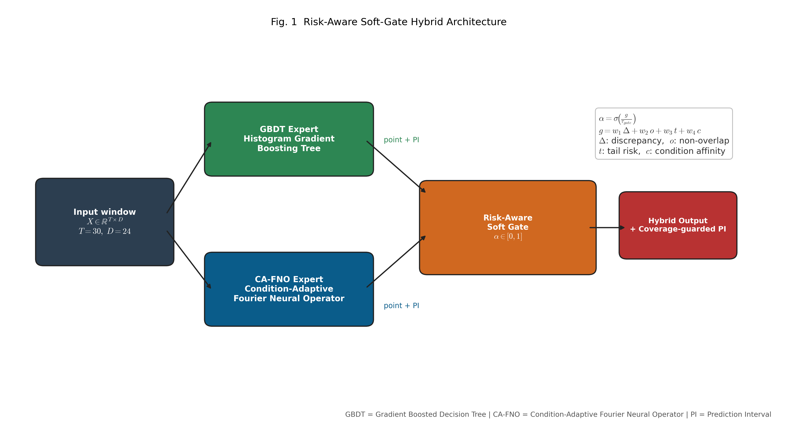

# cmapss-fd004-rul-mlops

[](https://github.com/yskfuji/cmapss-fd004-rul-mlops/actions/workflows/ci-stable.yml)
[](https://github.com/yskfuji/cmapss-fd004-rul-mlops/actions/workflows/ci-experimental.yml)

NASA CMAPSS FD004 の Remaining Useful Life 予測を題材にした、公開ポートフォリオ向けのリポジトリである。

> 研究およびポートフォリオ提示を目的とする。産業設備向けの参照実装であり、実運用システムの保証を主張するものではない。

**言語:** [英語](README.md) | 日本語

## ポートフォリオ版

- 公開ポートフォリオ版タグ: `0.0.0`
- バージョン表記の基準: `pyproject.toml`、`package.json`、FastAPI の OpenAPI metadata、`CHANGELOG.md`
- 関連 Runbook:
  - `docs/runbooks/operations.md` / `docs/runbooks/operations.ja.md`
  - `docs/runbooks/release.md`
  - `docs/governance/`

## このリポジトリが示すもの

- FD004 向けの再現可能な公開 GBDT ベンチマーク
- forecast、backtest、jobs、metrics、monitoring を公開する FastAPI サービス
- その周辺を支える release、audit、drift、promotion、approval などの運用統制

主役は公開ベンチマークと API である。OIDC、tenant policy、audit logging、job orchestration は、それらを支える control plane の設計を示す補助的な実装として位置づける。

## 公開アーキテクチャ

<p align="center"></p>

既定の公開フローは次のとおりである。

1. FD004 の前処理と運転条件を意識した正規化
2. センサ履歴からの rolling feature 生成
3. HGB に基づく点推定および区間推定モデル
4. 残差校正と、監視フック付きの API 配信

## 品質保証の構成

本リポジトリは CI、CD、および複数層のテストを含む。

| 対象 | 内容 |
|---|---|
| `.github/workflows/ci-stable.yml` | lint、security audit、typecheck、stable test、PostgreSQL compose integration、benchmark check、DVC dry-run、後段の e2e を実行する |
| `.github/workflows/ci-experimental.yml` | torch / hybrid 系の experimental model 向けテストと、対象を絞った coverage gate を実行する |
| `.github/workflows/cd.yml` | GHCR への image build / publish、Cloud Run への deploy、deploy 後の smoke check を実行する |
| `tests/unit/` | helper、service、runtime utility、model adapter などの unit test |
| `tests/integration/` | API、job-store、PostgreSQL、各 endpoint の integration test |
| `tests/monitoring/` | drift、metrics 描画、monitoring 永続化の確認 |
| `tests/regression/` | benchmark artifact の回帰閾値の確認 |
| `tests/frontend/` | ブラウザ側 controller の test |
| `tests/e2e/` | Playwright による smoke test と UI フロー検証 |

冒頭のバッジから stable / experimental workflow を確認できる。上記パスは GitHub Actions で実行している検証レイヤーに対応する。

## 公開ベンチマークの要点

基準となる artifact は `src/forecasting_api/data/fd004_benchmark_summary.json` としてコミットしている。

- 評価対象: 237 台の対象 test engine の最終サイクル予測
- 学習プロファイル: engine ごとの full cycle
- ベンチマーク stage: `gbdt-only`
- preset: `full`
- ensemble flag: `RULFM_BENCHMARK_ENABLE_GBDT_ENSEMBLE=0`

代表モデルの公開値:

- RMSE: 15.1594
- MAE: 10.4467
- NASA score: 968.3299
- bias: -2.2130
- cov90: 0.9114

過去の公開 snapshot では、学習ラベルの範囲が実質 `[0, 89]` に縮み、大きな負方向の bias が出ていた。現行の benchmark では全 cycle 学習へ切り替え、ラベル範囲 `[0, 125]` を回復している。

## 最小セットアップ

```bash
pip install -r requirements-lock.txt
export RULFM_FORECASTING_API_KEY=local-demo-key
PYTHONPATH=src uvicorn forecasting_api.app:create_app --factory --port 8000
```

control plane の追加設定や PostgreSQL 構成は、`docs/runbooks/operations.md` と `docs/runbooks/operations.ja.md` を参照する。

## ベンチマーク再現

```bash
RULFM_BENCHMARK_STAGE=gbdt-only \
RULFM_BENCHMARK_GBDT_PRESET=full \
RULFM_BENCHMARK_ENABLE_GBDT_ENSEMBLE=0 \
PYTHONPATH=src python scripts/build_fd004_benchmark_summary.py
```

## API と監視

- API docs: `/docs`, `/docs/en`, `/docs/ja`
- health: `/health`
- metrics: `/metrics`
- UI: `/ui/forecasting/`

`/metrics` には認証が必要である。公開向け quickstart では最小限の API key 構成のみを扱い、tenant policy や train approval などの高度な統制は runbook 側に分けて記載する。

## このリポジトリの位置づけ

本リポジトリは、「すでに大規模本番運用されている SaaS」であることを示すものではない。次の観点を備えた本番志向のリファレンス実装として読むのが適切である。

- 再現可能な benchmark
- API と非同期 job 面
- drift / metrics / promotion の観測面
- Cloud Run / Cloud SQL / GCS を前提にした control plane の設計

## 日英ドキュメント一覧

| ドキュメント | 英語 | 日本語 |
|---|---|---|
| README | [README.md](README.md) | このファイル |
| 運用 Runbook | [operations.md](docs/runbooks/operations.md) | [operations.ja.md](docs/runbooks/operations.ja.md) |
| アーキテクチャ概要 | [overview.en.md](docs/architecture/overview.en.md) | [overview.md](docs/architecture/overview.md)（EN/JA 混在） |
| ADR 群 | [docs/adr/](docs/adr/) | 各 ADR ファイル内に EN/JA 併記 |
| governance / release | [docs/governance/](docs/governance/) / [release.md](docs/runbooks/release.md) | 各ファイル内に EN/JA 併記 |
